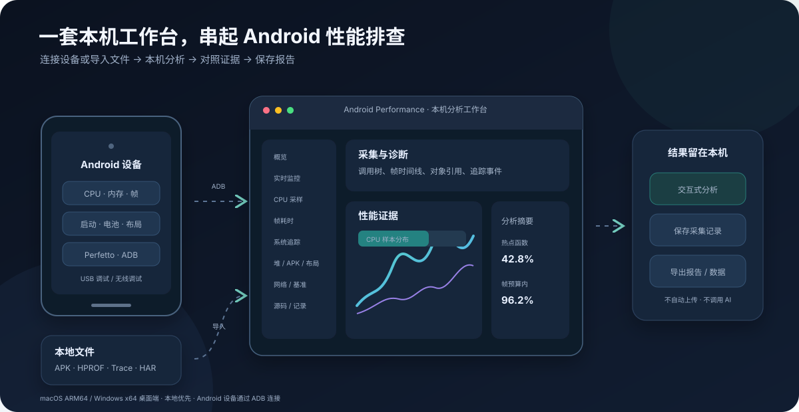
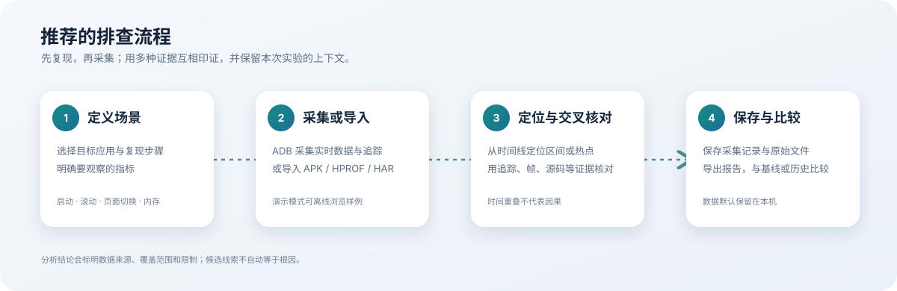

# Android Performance Workbench · 操作手册

面向 **macOS Apple Silicon 与 Windows x64** 的本机 Android 性能分析桌面工具。通过 ADB 连接设备，或导入已有文件，完成 CPU、内存、帧、启动、布局、系统追踪、网络、基准和 APK 分析。



> macOS ARM64 已完成本机打包和桌面验证；Windows x64 已加入构建与安装检查流程，原生安装验收仍待完成。当前不提供 Release 发布或安装包上传。AI 分析暂不实现。

## 目录

- [1. 先了解运行条件](#1-先了解运行条件)
- [2. 安装准备与启动](#2-安装准备与启动)
- [3. 连接设备与选择应用](#3-连接设备与选择应用)
- [4. 工作台与通用操作](#4-工作台与通用操作)
- [5. 实时监控](#5-实时监控)
- [6. CPU 采样与 ART 方法跟踪](#6-cpu-采样与-art-方法跟踪)
- [7. 帧耗时分析](#7-帧耗时分析)
- [8. 启动测试](#8-启动测试)
- [9. 内存与堆分析](#9-内存与堆分析)
- [10. 布局检查与 Compose](#10-布局检查与-compose)
- [11. 系统追踪与 Perfetto](#11-系统追踪与-perfetto)
- [12. 电池与资源](#12-电池与资源)
- [13. 网络分析](#13-网络分析)
- [14. GPU 产物](#14-gpu-产物)
- [15. 基准对比与 Macrobenchmark](#15-基准对比与-macrobenchmark)
- [16. APK 分析](#16-apk-分析)
- [17. 源码工作区](#17-源码工作区)
- [18. 保存导出与回放](#18-保存导出与回放)
- [19. 设置与快捷键](#19-设置与快捷键)
- [20. 常见问题](#20-常见问题)
- [21. 数据位置与隐私](#21-数据位置与隐私)
- [22. 验证记录与开发命令](#22-验证记录与开发命令)

## 1. 先了解运行条件

### 1.1 电脑与工具

| 使用方式 | 需要准备 |
| --- | --- |
| 从源码启动 | macOS ARM64 或 Windows x64、Node.js 22+、npm；按所用功能准备下表中的工具 |
| 使用已在本机生成的桌面包 | 运行构建生成的应用；准备完整的包已包含对应工具，运行时不需要 Node.js |
| 设备采集 | 可用的 USB/无线 ADB 连接；某些功能还要求应用允许调试或性能剖析 |
| 离线分析 | 已有 APK、HPROF、perf.data、ART trace、Perfetto trace、HAR 或 Benchmark JSON；不需要设备 |
| 完整运行时布局检查 | 兼容目标应用、Android API 29+、Inspector JAR 与 Java 25 |

| 工具 | 主要用途 | 准备命令 |
| --- | --- | --- |
| ADB、AAPT2 | 设备通信、APK Manifest/资源解析 | `npm run prepare:desktop-tools`，从本机 Android SDK 复制 |
| simpleperf、Python runtime | CPU 设备采样、perf.data 解析 | `npm run prepare:simpleperf`，需要稳定版 Android NDK |
| LLVM symbolizer / cxxfilt | Native ELF 源码行与 C++ 名称解析 | `npm run prepare:native-symbolizer`，需要 Android NDK |
| Trace Processor | 系统追踪、heapprofd、Binder 等查询 | `npm run prepare:trace-processor` |
| Perfetto UI | 本机完整追踪界面 | `npm run prepare:perfetto-ui` |
| Shark、Java runtime | Android HPROF 泄漏分析 | `npm run prepare:shark` |
| Inspector Java 25 | 完整 View/Compose Inspector | `npm run prepare:inspector-runtime` |

只使用 APK 分析时，不必先准备 CPU、Shark 和 Inspector 工具。完整打包前应准备构建配置列出的全部资源。Inspector JAR 已随项目提供，更新资源使用 `npm run prepare:ui-inspector`。

### 1.2 Android 版本与应用条件

| 功能 | 版本或条件 | Android 7.1 的使用情况 |
| --- | --- | --- |
| 实时 CPU、PSS/RSS、gfxinfo、启动、电池、基础布局 | ADB 授权、设备提供对应命令；字段随系统变化 | 已真机采集验证 |
| simpleperf | 目标与设备允许采样；项目提供旧设备兼容二进制 | 已得到有效 CPU 样本 |
| HPROF / Shark | 通常需要 debuggable 应用 | 已完成真实堆采集和分析 |
| ART 方法 trace | 运行中的目标应用允许 `am profile` | 日历演示应用成功；主目标 debug 应用返回空文件 |
| 完整 Compose Inspector | Android 10 / API 29+、兼容且可注入的目标 | 不支持这一检查器；可使用基础布局或可选应用内 Agent |
| Native heapprofd | Android 10 / API 29+、设备与目标允许 | 不支持 |
| FrameTimeline、ART 分配采样 | Android 12 / API 31+、系统实际提供数据 | 不支持 |
| 系统 Bitmap PNG heap dump | Android 15 / API 35+ | 不支持；普通 Bitmap Java 缓冲区查询仍可用 |
| Perfetto 系统采集 | 当前工作台要求设备内置 `perfetto` | 本次设备没有该程序；工作台尚未实现旧版 atrace 采集回退 |

Android 7.1 设备仍可提供 `atrace`。本次设备实际列出了调度、频率、View、Activity、Binder 等类别；“当前工作台不能录制 Perfetto”不代表该设备完全不能做系统追踪。旧版采集兼容通道尚待补充。

## 2. 安装准备与启动

### 2.1 安装源码依赖

在项目根目录打开终端，执行：

```sh
npm ci
```

需要设备通信或 APK 分析时，在 Android SDK Manager 安装 Platform Tools、Build Tools；使用 CPU / Native 工具时再安装稳定版 NDK。找不到 SDK 时，设置环境变量后重新打开终端。

macOS 常见 SDK 路径：

```sh
export ANDROID_SDK_ROOT="$HOME/Library/Android/sdk"
```

Windows PowerShell 常见路径：

```powershell
$env:ANDROID_SDK_ROOT = "$env:LOCALAPPDATA\Android\Sdk"
```

### 2.2 准备完整桌面功能

```sh
npm run prepare:desktop-tools
npm run prepare:simpleperf
npm run prepare:native-symbolizer
npm run prepare:trace-processor
npm run prepare:perfetto-ui
npm run prepare:shark
npm run prepare:inspector-runtime
```

首次准备会下载部分分析器与运行时；部分命令从本机 SDK/NDK 复制资源。准备失败时，先处理对应工具的报错，再重试该命令。

Windows 的 Inspector runtime 从本机 Java 25 安装复制。先安装 Java 25，并将 `JAVA_HOME`、`JAVA_HOME_25_X64` 或 `APW_INSPECTOR_JAVA_HOME` 指向安装根目录，再执行 `prepare:inspector-runtime`。Shark 在 Windows 上使用本机 Java 17+；macOS 的 Shark 准备脚本下载已校验的 Java 17 runtime。

### 2.3 启动桌面版

```sh
npm run desktop
```

启动后会打开原生桌面窗口，本地后端随应用启动。关闭最后一个窗口在 Windows 上会退出；macOS 可通过应用菜单退出。

只需本地浏览器开发模式时：

```sh
npm start
```

打开 `http://127.0.0.1:4318`。浏览器模式不提供全部原生目录选择和外部应用交接能力，日常操作优先使用桌面版。

### 2.4 本机构建

在对应系统准备好工具后执行其中一个命令：

```sh
# macOS ARM64
npm run package:mac

# Windows x64
npm run package:win
```

macOS 输出位于 `dist/v<版本>/mac-arm64/Android Performance.app`；Windows 输出 MSI 和 NSIS 安装程序。两个命令均使用 `--publish never`，只生成本地文件。Windows 构建配置已加入，实际安装和启动验收仍待 Windows 主机执行。

## 3. 连接设备与选择应用

### 3.1 USB 连接

1. 在 Android 设备打开开发者选项和 USB 调试。
2. 使用支持数据传输的线连接电脑，解锁设备并接受调试授权。
3. 在工作台刷新设备列表，选择状态为已连接的设备。
4. 刷新应用列表，选择要分析的包名。
5. 在设备上打开目标应用，再进入需要的分析页面。

必要时在终端检查：

```sh
adb devices -l
```

没有配置全局 ADB 时，可使用项目中的 `tools/platform-tools/adb`；Windows 使用 `tools\platform-tools\adb.exe`。桌面菜单 **文件 → 选择 ADB 程序…** 也可指定自有 ADB。显式设置的 `ADB_PATH` 优先于自动查找。

| 设备状态 | 操作 |
| --- | --- |
| `device` | 可以选择并采集 |
| `unauthorized` | 在设备上接受 USB 调试授权；必要时重新插线 |
| `offline` | 检查线缆、USB 模式与设备状态，然后重连 |
| 没有设备 | 先确认终端与工作台使用同一个 ADB，再检查驱动/线缆 |

Windows 若设备不能被 ADB 识别，还需确认厂商 USB 驱动正常。

### 3.2 无线连接

支持配对式无线调试的设备，可在终端完成 `adb pair 地址:配对端口`，再执行 `adb connect 地址:调试端口`，之后回工作台刷新设备。两种端口可能不同。

旧设备没有配对入口时，需要先按该设备支持的方式启用 ADB TCP 连接，再执行 `adb connect`；Android 7.1 不能直接套用新系统的配对流程。当前工作台不内置配对向导。

### 3.3 没有设备时

可进入演示模式熟悉页面，或直接导入已有文件。演示数据有明确标记，不代表真实采集；依赖真实文件或设备身份的保存、追踪关联等操作会受限制。

## 4. 工作台与通用操作

工作台共 16 页：概览、实时监控、CPU 采样、帧耗时分析、启动测试、电池与资源、GPU 产物、堆转储、布局检查、系统追踪、网络分析、基准对比、APK 分析、源码工作区、采集记录、设置与帮助。



一次可复核的实验建议按下列顺序进行：

1. 记下设备、应用版本、构建类型和操作步骤。
2. 选择模块，确认设备、包名、采集时长及过滤条件。
3. 开始采集，并在设备上复现相应场景。
4. 停止采集，先检查是否确实产生有效样本和警告。
5. 保存原始文件及分析结果；需要比较时，再执行相同场景生成另一组数据。

同一设备上的采集任务可能互斥。按钮禁用时，查看是否有正在运行的任务、缺少设备/应用、尚未准备分析工具，或系统版本不符合要求。时间重叠和自动标记只是排查线索，不能单独证明根因。

### 按问题选择入口

| 要排查的问题 | 建议起点 | 接下来保留的证据 |
| --- | --- | --- |
| 页面卡顿或滚动不流畅 | 帧耗时分析 → CPU 采样；设备支持时补系统追踪 | gfxinfo、perf.data、追踪及相同操作步骤 |
| 启动变慢 | 启动测试 → 对比两份同条件实验 | 逐轮 JSON/CSV、构建与编译状态；支持时补启动追踪 |
| 内存持续上涨 | 实时监控 → 业务操作前后 HPROF | 两份原始堆、mapping、类差异和 Shark 报告 |
| 网络响应慢 | 导入 HAR，或接入 Agent 后网络分析 | 脱敏请求记录、筛选范围和阶段耗时 |
| APK 体积或架构问题 | APK 分析 | APK 原文件、文件分类/ABI 信息及分析报告 |
| 布局与 Compose 问题 | 基础布局 → 按需 Agent / 完整 Inspector | 布局档案、截图、基线和实际运行时证据 |

Android 7.1 用户首次可依次完成“实时监控 → 重置后复现并读取 gfxinfo → 活动窗口 CPU 采样 → HPROF”。系统追踪录制、FrameTimeline 和高版本专属功能按第 1 节的支持范围处理。

## 5. 实时监控

**用于**：观察应用运行期间 CPU、内存和设备电池读数的变化。

1. 运行目标应用，打开 **实时监控**。
2. 点击 **采集一次** 检查进程和内存是否有有效值。
3. 点击 **开始采集**，在设备上执行需要观察的操作。
4. 观察 CPU、PSS/RSS、内存组成及警告；完成后点击 **停止采集**。
5. 点击 **保存记录**，以后可在采集记录中回放。

CPU 的首个样本可能需要建立基线；进程重启后也会重建。主进程 `/proc` 口径单核占满为 100%，多核可超过 100%。权限不足时可能回退为 `dumpsys cpuinfo` 窗口统计，页面会说明来源。设备电池温度、电量不等于目标应用耗电。

## 6. CPU 采样与 ART 方法跟踪

### 6.1 采集 simpleperf

1. 打开 **CPU 采样**，确认应用正在运行且允许采样。
2. 点击 **读取设备事件**；选择设备实际支持的事件，最多同时选择 8 个。
3. 选择采集时长、频率和 FP/DWARF 展开方式。首次可用短时长、较低频率，减少调试开销。
4. 点击 **采集 perf.data**，在采集期间操作应用，例如滚动、打开页面或返回页面。
5. 等待采集与解析完成，检查样本数、事件、警告以及丢失/截断诊断。
6. 用调用树、火焰图、线程和时间筛选缩小范围，查看热点与样本完整调用栈。
7. 点击 **保存采样** 保存原始采样档案，或 **导出报告** 保存分析 JSON。调用栈时间图还可导出当前视图 PNG。

需要提前结束时点击 **取消 CPU 采集**，等待清理完成后再开始新任务。

若文件生成成功但没有调用栈，先确认采集窗口内应用有实际活动。此次 Android 7.1 真机静止采样没有有效栈，加入页面恢复操作后得到 310 个真实样本。采样权重表示事件周期，不能直接作为函数 CPU 百分比或精确运行时长。

### 6.2 导入和补充符号

- **导入 perf.data**：选择原始 simpleperf 文件；多事件文件可切换事件重新分析。
- **导入 folded stacks**：适合已有折叠栈文本；没有原始采样时间与 DSO 信息时，对应筛选不可用。
- 指定 `symfs` 符号目录后点击 **重新解析符号**。目录中的 ELF 应与采样构建匹配。
- Native 源码行定位还需要匹配的 Build ID 与 DWARF 行表；没有匹配信息时会保留未知，不能拿其他构建的符号替代。

### 6.3 ART 方法跟踪

1. 保持目标应用运行，在同一页面选择 ART 跟踪时长和采样间隔。
2. 点击 **采集 ART trace**，采集中复现场景；需要时使用 **取消 ART 采集**。
3. 查看方法时间线、线程、调用次数、包含时间和自身时间。
4. 已有 `.trace/.dmtrace` 可通过 **导入 ART trace** 分析；分析报告由 **导出报告** 保存。

支持标准文本头及可兼容的 streaming 格式。ART 采样/方法跟踪的时间口径与 simpleperf 不同，不能直接混合比较。若返回空文件，可换一个确认可调试的应用交叉验证。本次日历演示应用的 Android 7 ART v3 文件解析成功，`com.xmotion.sui.debug` 仍返回空文件，原因未确定。

## 7. 帧耗时分析

### 7.1 gfxinfo 基础流程

1. 打开 **帧耗时分析**，点击 **重置设备统计**，只清空性能统计缓冲，不清除应用数据。
2. 在设备上复现滚动、动画、切页等场景。
3. 点击 **读取帧数据**，设置与目标刷新率相符的预算。
4. 查看逐帧耗时、分位数、超预算比例和连续超预算分组。
5. 点击 **保存记录**；已有 `dumpsys gfxinfo … framestats` 输出可用 **导入 gfxinfo 文本**。

60 Hz 的一帧预算约 16.67 ms；不同刷新率应按目标设置。样本只有几帧、只含启动或恢复动画时，不宜据此评价日常流畅度。自选预算超限与 Android 平台的 Jank 分类不是同一个指标。

### 7.2 FrameTimeline 与 JankStats

Android 12+ 设备可先在系统追踪页面录制 FrameTimeline，再查看实际/预期帧和系统 Jank 分类。gfxinfo、布局、CPU、网络或 JankStats 证据只有满足设备、包名、PID、时钟与会话条件时才可关联；导入文件不会自动获得真实设备身份。

JankStats 需要在目标 debug 应用接入可选 Agent。通过 **下载 JankStats Agent 源码** 获取文件，按 [JankStats 接入说明](android-agent/JANKSTATS_AGENT_README.md) 编译安装后，点击 **读取应用 JankStats**；可导出 JSON。没有接入或没有产帧时，显示空结果是正常情况。

## 8. 启动测试

1. 打开 **启动测试**，选择冷、温或热启动及轮数。
2. 编译模式首次选 **保持现状**。选择 `speed-profile` 或 `speed` 会主动改变目标包的 ART 编译状态。
3. 点击 **开始测试**，等待各轮结束，期间保持固定设备状态，避免手动操作干扰。
4. 查看每轮 `TotalTime`、P50/P90、均值和波动，并检查设备是否报告实际启动模式。
5. 点击 **保存记录**，或使用 **导出实验 JSON**、**导出轮次 CSV**。
6. 比较版本时，保存两份同条件实验，再在“启动实验对比”中选择基线和当前记录。

冷启动会 force-stop 应用；温/热启动按不同操作协议执行。设备没有报告 LaunchState 时保留未知。`TotalTime` 不等于用户可交互或完全绘制时间。

需要 Application/Activity/PreDraw/fully-drawn 里程碑时，使用 **下载 Startup Agent 源码**，按 [Startup 接入说明](android-agent/STARTUP_AGENT_README.md) 接入 debug 构建后再读取。也可选择逐轮读取 Agent 或系统事件；这会增加实验总耗时，缺少 fully-drawn 事件时不会生成 TTFD。

## 9. 内存与堆分析

### 9.1 采集或导入 HPROF

1. 打开 **堆转储**，选择运行中的可调试应用，点击 **采集 HPROF**。
2. 等待设备生成、拉取并解析文件。堆转储可能暂停应用，较大快照会占用电脑内存。
3. 检查类数量、对象统计、索引上限或截断提示，搜索目标类。
4. 进入实例查看字段、字符串/数组内容、引用来源及候选根路径。
5. 按需使用 **查看近似支配图**、**重复字符串**、**重复 Bitmap 缓冲区**、**已销毁 Activity** 等查询。
6. 保留下载的原始 `.hprof`，并使用当前视图的 CSV / Markdown / JSON 导出。

已有文件使用 **导入当前快照**。HPROF 不是普通采集记录 JSON；以后复查对象图需要重新导入原始文件。

### 9.2 快照比较与 Shark

- 比较前后状态：先导入一份 **基线快照**，再导入当前快照，查看类数量和数据变化。按相同业务步骤采集两份快照，避免把不同进程或构建的差异直接当成泄漏。
- 需要 Android 泄漏分析：点击 **Shark Android 泄漏分析**，等待报告生成，再导出原始 TXT 或 JSON。
- 存在 R8/ProGuard 混淆时，载入同一构建的 mapping 文件；需要时使用 **移除映射**。映射用于根栈还原，并在 Shark 已配置时传给 Shark。
- 普通引用路径、近似支配图、Activity 候选与 Shark 报告分别表达不同证据；对象仍被引用或两次快照增长，不能单独证明泄漏。

当前索引最多 100 万对象、150 万引用边，超限会标记不完整。字段/数组记录字节数不等于对象浅大小或精确保留大小；近似支配图不完整处理所有强弱引用语义。

### 9.3 Bitmap 与分配剖析

普通 HPROF 可查询已记录的 Bitmap Java 字段和 byte[]，导出原始 `.bin` 缓冲区。该文件不是 PNG，也不保证包含 native 或硬件像素。Android 15+ 的 **采集 Bitmap PNG 转储** 是另一条系统路径，仅对实际记录且校验通过的 PNG 提供导出。

Native/ART 分配剖析需要受支持的系统和应用。选择模式及采集参数后采集，或导入已有 heapprofd Perfetto 文件；在结果中选择具体 dump 区间，按分配字节或次数查看调用树与火焰图。Native 还可显示未释放估计，ART 不提供该指标。这些值不等于 HPROF 存活对象或精确保留大小。

生命周期观察和 JankStats 注入是可选操作，接入说明见 [LeakCanary/生命周期 Agent](android-agent/LEAKCANARY_AGENT_README.md)。注入后需自行构建安装 debug 变体。

## 10. 布局检查与 Compose

### 10.1 基础布局与差异

1. 在设备上停留在要检查的页面，打开 **布局检查**。
2. 使用 **UIAutomator 回退** 采集可访问性层级和截图。
3. 在树中搜索或选择节点，查看属性与截图上的边界；需要时 **隔离选中节点**，再 **显示全部**。
4. 点击 **保存快照**。修改页面后重新采集，将旧快照 **载入为基线**，比较新增、移除、属性及位置变化。
5. 外部参考图可叠加对齐，调整透明度、缩放和平移，必要时 **复位对齐**。
6. 交换完整结果使用 **导出采集档案** / **导入完整档案**；只有 XML 时使用 **导入 XML**。

UIAutomator 不是完整 View/Compose 实例树。截图与层级不是同一时刻原子采集，动画期间可能错位；重复资源 ID 也可能产生身份歧义。触控尺寸、透明节点等检查线索需要人工复核。

### 10.2 应用内 Agent 与完整 Inspector

- 更完整的应用内 View/Compose 信息：按 [布局 Agent 接入说明](android-agent/LAYOUT_AGENT_README.md) 将源码接入 debug 构建，重新安装应用，在桌面配置一致的临时令牌后采集。
- 完整 Compose Inspector：Android 10+、Inspector JAR 和 Java 25 准备完成后，使用页面中的完整检查器入口。可查看实例参数、Modifier、语义树、源码位置，并对大参数续读或导出 JSON。
- 资源解析栈为可选项，首次启用可能修改调试设置并重启 Activity；安全窗口和部分硬件合成内容无法保证截图完整。
- Compose Compiler 的 `composables.txt/.csv`、`classes.txt` 可导入查看静态稳定性；它们不是运行时重组次数。
- 运行时 Probe 或自动编译器插件需要额外接入；当前自动插件匹配 Kotlin 2.2.21。State 读取关系、apply 与执行时间只提供候选线索，不证明重组或卡顿因果。

## 11. 系统追踪与 Perfetto

### 11.1 录制、导入和查询

1. 打开 **系统追踪**，确认设备报告可用的 Perfetto。
2. 选择录制时长、模式以及可选应用 ATrace/功耗设置；FrameTimeline 需要 Android 12+。
3. 点击 **开始录制**，在设备上复现场景；完成后保留原始文件并等待载入。
4. 查看摘要、事件切片和时间窗口，按线程查看调度状态；需要时展开 Binder、GPU、启动或功耗诊断。
5. 点击 **在本机完整 Perfetto 中查看**，进入内嵌完整 UI。
6. 如需自定义查询，在工作台执行只读 `SELECT` / `WITH`，再导出 CSV 或包含查询结果的分析报告。
7. 点击 **保存到本机** 保存追踪档案，或 **导出原始追踪** / **导出分析报告 JSON**。

已有文件直接使用 **导入追踪**。缺少对应数据源的追踪不能产生 FrameTimeline、GPU、GC 或功耗结果；“无数据”不代表相关活动耗时为零。更换追踪会话后，应重新读取诊断，避免使用上一份结果。

### 11.2 Android 7.1 的情况

本次设备没有 `/system/bin/perfetto`，所以当前录制入口无法使用。设备有 `atrace`，但工作台尚未提供自动回退采集按钮。可导入本工具和 Trace Processor 支持的已有追踪文件进行离线分析；旧设备自动采集能力应以实际实现为准。

本机内嵌 Perfetto 由 `prepare:perfetto-ui` 准备。分享功能默认关闭；菜单中的外部 Perfetto 网站入口与本机内嵌界面是两个入口。

## 12. 电池与资源

1. 打开 **电池与资源**，选择设备和应用，点击 **采集基线**。
2. 在设备执行固定场景，结束后点击 **采集结束快照**。
3. 检查统计窗口、UID 和包名是否一致，再查看网络字节、唤醒锁、闹钟、作业等差值。
4. 连续实验可设置采样次数与间隔；中途停止会保留已采样结果。
5. 使用 **保存实验** 或 **导出报告**。需要原始兼容数据时，点击 **导出 Battery Historian 数据**。
6. 已有数据用 **导入 checkin**；历史实验可分别 **设为基线**、**设为结束快照**。

统计属于 UID 的累计窗口，共享 UID 无法拆分。窗口重置或计数下降时不能直接求差。mAh、ODPM 是系统模型/硬件支持下的估算，硬件功耗轨道也不等于应用耗电。设备导出的 checkin 会重新读取当前数据，不一定是此前快照对应的原始文本。

## 13. 网络分析

### 13.1 导入 HAR

1. 打开 **网络分析**，点击 **导入 HAR**。
2. 按域名/路径、方法、状态、连接标识、耗时和开始时间筛选。
3. 查看筛选后的请求数、失败、P50/P95、阶段耗时、活动时间线和峰值并发。
4. 点击请求查看详情；缺失的 DNS/TLS 等阶段保持未知。
5. 使用 **保存分析**，或 **导出筛选 CSV / HAR / JSON**。

导入和导出会丢弃凭据、query、fragment、Headers、Cookies 和正文。路径仍可能包含业务信息；Agent 默认不采路径，启用 PathSanitizer 后由应用提供脱敏端点。

### 13.2 真实请求与 Agent

1. 点击 **下载 Agent 源码**，按 [网络 Agent 说明](android-agent/README.md) 接入目标 debug 应用的 OkHttp。
2. 重新编译安装并运行应用，在工作台生成或配置相同的临时令牌。
3. 启动 Agent 采集，复现网络操作，观察增量请求，结束后停止采集。
4. 新协议使用 ADB forward 与本机抽象 socket；空令牌保留旧 Logcat 兼容路径。

未接入 Agent 时，可以分析导入 HAR 或读取系统 UID 流量，但不能自动看到任意应用的请求、域名和正文。**映射到追踪帧** 还需要同设备/包名/进程及可用时钟快照；时间重叠不证明网络导致卡顿。

## 14. GPU 产物

1. 打开 **GPU 产物**，按需点击 **读取设备能力** 查看系统报告的 GLES/Vulkan。
2. 用外部 AGI 完成设备兼容性检查和捕获；在本机得到 `.gfxtrace` 或兼容追踪文件。
3. 点击 **导入产物**，查看文件信息和 SHA-256 校验状态。
4. 桌面版可 **选择 AGI**、**启动 AGI**，并将校验后的帧捕获交给 AGI 打开；系统追踪文件可送入追踪分析。

本页面不内置 AGI，也不直接执行 GPU 帧捕获。文件校验只能确认导入后是否变化，不能证明来源或格式可信。设备没有 GPU 轨道时，追踪诊断不会补造 GPU 数据。

## 15. 基准对比与 Macrobenchmark

### 15.1 比较已有报告

1. 在 **基准对比** 导入 AndroidX Benchmark 基线和当前 JSON 报告。
2. 核对测试名称、参数、设备和运行环境是否可比。
3. 为各指标选择“越低越好”或“越高越好”，再设置回归阈值。
4. 查看逐指标差值、分布和环境差异提示。
5. 保存运行，或导出对比 JSON、CSV、Markdown、CI 结果。

多份独立保存报告可以用于报告级 Bootstrap 描述性比较；同一报告里的多次 runs 不等于多个独立实验，区间也不是性能因果证明。

### 15.2 运行设备测试或工程

- 已安装 instrumentation：填写相应组件/测试类，点击 **运行测试**，再 **读取设备报告**。
- Macrobenchmark 工程：**选择目录**，指定真实 Gradle 任务（例如 `:macrobenchmark:connectedBenchmarkAndroidTest`），配置启动/编译模式、场景、预热、迭代和可选 Baseline Profile，再点击 **构建并运行**。
- 工程需要有效 Gradle Wrapper、AndroidX Benchmark 模块、可用完整 JDK 和已连接设备。首次构建可能下载工程依赖。
- 运行后读取本次更新的标准报告；发现追踪文件后使用 **导入追踪分析**。自定义输出路径可能需要手动导入报告。

目标工程必须显式读取传入的 APS Gradle properties / 环境变量；填写参数不保证目标测试已采用。Baseline Profile 文件仅传递路径和身份，不由工作台自动安装或启用。构建会执行所选工程的 Gradle 代码。

## 16. APK 分析

1. 打开 **APK 分析**，点击 **选择本地 APK**。
2. 等待本机解析，依次查看概览、文件、权限、组件、DEX、签名结构和 Manifest 页签。
3. 在文件清单按路径或类别筛选；查看体积主要来自资源、DEX、assets 还是 native 库。
4. 在 ABI 和原生库区检查目标架构，在 DEX 区查看文件头统计；它们不代替源码/字节码级审计。
5. 点击 **保存分析**，以后从采集记录回放；点击 **导出报告** 保存 JSON。

一次处理一个 APK；split APK 的结果仅覆盖选中的文件，不合并整个安装集合。证书页提取签名结构和证书信息，不做密码学签名完整性或证书信任链验证。静态分析不安装或运行 APK。

## 17. 源码工作区

1. 打开 **源码工作区**，点击 **选择目录**，再 **创建快照**。
2. 远程源码使用受支持的公开 GitHub/AOSP 仓库地址和 ref，点击 **获取远程快照**；本机记录完整提交 ID。
3. 选择快照后，使用 **文本搜索** 或 **定位声明候选**，打开匹配文件。
4. 从 CPU 或布局结果定位源码时，先确认已有对应源码快照；候选需要核对包名、方法、路径和构建。
5. 混淆构建准备匹配的 mapping；Native 精确行定位还需要同 Build ID 的 ELF 与 DWARF 行表。

快照不是 IDE 工程。它最多收集 5,000 个文本文件、32 MiB；跳过大部分构建产物、符号链接、子模块与 LFS 内容，并额外收集 Gradle mapping 输出。声明匹配是候选，不能自动确认与设备 APK 是同一构建。

## 18. 保存导出与回放

### 18.1 选择正确的保存方式

| 数据 | 建议保留 | 以后如何打开 |
| --- | --- | --- |
| 监控、帧、启动、布局、网络、APK、基准报告 | 页面保存的记录，以及所需 JSON/CSV 报告 | **采集记录** 载入；外部记录 JSON 用 **导入记录** |
| CPU simpleperf | 原始 perf.data、本机采样档案、分析 JSON | CPU 页 **载入采样** 或 **导入 perf.data** |
| ART 方法 trace | 原始 `.trace/.dmtrace`、分析 JSON | CPU 页 **导入 ART trace** |
| HPROF | 原始 `.hprof`、匹配 mapping、Shark/表格报告 | 堆转储页重新导入 |
| 系统追踪/heapprofd | 原始追踪、本机追踪档案、分析 JSON | 系统追踪或分配分析的对应导入入口 |
| 完整布局证据 | 含 XML、PNG 与元数据的采集档案 | 布局页 **导入完整档案** |
| GPU 文件 | 原始产物和本机索引 | GPU 产物页或外部 AGI |

CSV、Markdown 和分析 JSON 是结果快照，不能普遍替代原始二进制文件。界面显示某个筛选范围时，导出也可能只包含当前范围，应同时记录过滤条件。

### 18.2 记录操作

1. 在功能页面完成采集后，点击对应的保存按钮。
2. 打开 **采集记录**，刷新并选择记录载入。
3. 需要交换记录时导出记录 JSON，在另一实例通过 **导入记录** 载入。
4. 载入历史记录后核对设备、包名、时间和来源；开始新采集会使用当前选中的设备。
5. 本机采样/追踪档案载入前会核对 SHA-256，损坏文件应保留用于排查，不作为有效分析结果。

## 19. 设置与快捷键

在 **设置与帮助** 中切换简体中文/English、系统/浅色/深色主题及 90%–120% 缩放。桌面偏好退出后保留，原始设备输出与用户文件不会被自动翻译。

| 快捷键 | 功能 |
| --- | --- |
| `⌘/Ctrl+1` | 概览 |
| `⌘/Ctrl+2` | 实时监控 |
| `⌘/Ctrl+3` | 帧耗时分析 |
| `⌘/Ctrl+4` | 启动测试 |
| `⌘/Ctrl+5` | 布局检查 |
| `⌘/Ctrl+6` | 系统追踪 |
| `⌘/Ctrl+7` | 网络分析 |
| `⌘/Ctrl+8` | 基准对比 |
| `⌘/Ctrl+9` | APK 分析 |
| `⌘/Ctrl+O` | 采集记录 |
| `⌘/Ctrl+,` | 设置与帮助 |

菜单 **分析** 还提供 CPU、堆、电池、GPU 和源码页面入口；**文件 → 打开记录目录** 可定位本机数据。

## 20. 常见问题

| 现象 | 排查和处理 |
| --- | --- |
| 找不到设备或授权失败 | 检查 `adb devices -l`、USB 授权、线缆及 Windows 驱动；确认工作台选择的 ADB |
| 应用列表里找不到目标 | 核对实际包名、设备和系统用户；刷新列表 |
| CPU/PSS 显示不可用 | 先打开应用；等待建立基线；查看进程、权限与数据源警告 |
| perf.data 有文件却没有调用栈 | 在采样窗口复现活动、适当延长时长；核对事件、目标进程和采样权限 |
| CPU 符号是 unknown 或定位不到源码 | 检查 NDK/Python 工具、symfs、Build ID、DWARF 和源码快照是否匹配 |
| ART trace 为空 | 核对 debuggable、运行状态、应用及厂商 runtime；换已知可调试应用交叉验证，保留空文件失败结果 |
| HPROF 采集失败 | 检查目标是否允许 dumpheap、进程是否运行、设备和电脑存储/内存是否充足 |
| Shark 按钮不可用 | 执行 `prepare:shark`，确认 Java 可运行；普通 HPROF 查询不依赖 Shark |
| 帧数为 0 或很少 | 先重置统计，复现真实绘制，再读取；历史缓冲有限，某些渲染路径可能不进入该统计 |
| Android 7 的 Perfetto 按钮不可用 | 本次设备没有 perfetto；当前 atrace 自动采集回退尚未实现，基础 CPU/gfxinfo/HPROF 仍可使用 |
| Inspector 不可用或提示 class version | 检查 Android API、Inspector JAR、Java 25 和应用可注入性 |
| 布局缺少 Compose 节点 | UIAutomator 只给可访问性层级；需要兼容 Agent 或完整 Inspector |
| 网络页面没有请求 | HAR 是否导入？目标是否接入并运行 OkHttp Agent？令牌是否一致？UID 字节统计不会自动变成请求明细 |
| 电池差值不可用 | 检查 UID、设备和累计窗口是否一致；统计重置、缺项、共享 UID 都会限制解释 |
| Macrobenchmark 不能运行 | 检查 Wrapper、Gradle 任务、完整 JDK、Android SDK、设备及工程是否读取 APS 参数 |
| APK 的 Manifest 解析失败 | 检查 AAPT2 是否准备；保留报错与 APK 变体信息，不能用空结果当作成功 |
| 某个按钮禁用或提示任务忙 | 检查运行任务、演示模式、设备/应用选择、系统版本和工具可用性；等待停止/取消清理结束 |
| 本机服务端口占用 | 浏览器开发模式指定其他 `PORT`；桌面模式自动选择本机端口 |
| Windows 构建完成但不能运行 | Windows 原生验收仍待执行；保留安装/启动报错，不以 macOS 测试替代 Windows 结果 |

源码浏览器模式指定端口/ADB 的示例：

```sh
# macOS
ADB_PATH=/path/to/adb PORT=4319 npm start
```

```powershell
# Windows PowerShell
$env:ADB_PATH = 'C:\Android\platform-tools\adb.exe'
$env:PORT = '4319'
npm start
```

## 21. 数据位置与隐私

- 桌面包：系统应用数据目录下的 `records/`，可从菜单打开。源码桌面模式：`data/desktop-profile/records/`；浏览器开发模式：`data/`。
- 本轮真机文件：`data/device-test-20261109-android71/` 与 `data/device-test-20261109-android71-profiling/`。目录已忽略 Git 提交。
- 导出的文件位于所选保存位置或浏览器下载目录。卸载或更换工作区前，先备份需要的原始文件和记录。
- 临时追踪在更换文件或正常退出时清除；异常终止可能残留临时副本。GPU 与 AGI 交接副本保留在应用数据目录的 `gpu-open/`，不再使用时可自行清理。
- 应用使用仅监听 `127.0.0.1` 的本机服务，并检查 Host、Origin 和启动令牌；Electron 启用 sandbox 与 context isolation。
- 应用不调用 AI，也不自动上传性能文件。工具准备、远程源码获取和外部网页入口需要网络；选择运行 Gradle 工程也可能下载依赖。
- 布局参数、截图、堆、源码和原始日志可能包含业务数据；网络导出虽有脱敏，分享前仍应检查内容。

| 主要限制 | 上限或行为 |
| --- | --- |
| APK | 512 MiB、50,000 文件、解压后总计 8 GiB |
| perf.data / 追踪 / HPROF 的主要分析路径 | 通常最多 256 MiB；以页面和具体接口提示为准 |
| GPU 产物 | 单个 512 MiB，送入追踪分析受其 256 MiB 限制 |
| 源码快照 | 5,000 文件、总计 32 MiB |
| 实时监控 | 最多保存 1,800 样本，图表显示最近 120 个 |
| HAR | 最多 50,000 请求，列表最多显示 1,000 个匹配项 |
| HPROF 对象图 | 最多索引 100 万对象、150 万引用边；超限标记不完整 |
| 布局完整档案 | 最大 48 MiB，XML、图片和节点各有子限制 |

更详细的查询上限、时钟、统计口径与高级能力见 [分析数据口径与详细限制](docs/ANALYSIS_DETAILS.md)。

## 22. 验证记录与开发命令

本手册对应当前工作区实现，验证结果和未完成项单独记录，避免把功能入口当成验收完成：

- [功能完整性检查](docs/COMPLETENESS_REPORT.md)：平台适配、发现的问题和剩余验收。
- [Android 7.1.2 真机采集报告](docs/DEVICE_TEST_20261109.md)：真实 CPU、HPROF、帧、布局、启动和 ART 交叉验证；包含目标 ART 空文件问题。
- [历史测试记录](TEST_REPORT.md)与 [APK 测试记录](APK_TEST_REPORT.md)。

最近完整自动回归：**477 项，460 通过、17 个可选外部样本跳过、0 失败**。macOS ARM64 桌面包已验证 16 页及主要导入、导出和回放流程。Windows 原生安装、新系统 FrameTimeline/完整 Inspector/heapprofd 等仍有待验收项。

```sh
npm run check  # JavaScript 语法检查
npm test       # 本机自动回归，HTTP 用例需要允许监听回环端口
```

真机采集脚本会实际操作目标，`--allow-app-control` 允许启动/重启应用、重置帧统计及 dumpheap；`--exercise-ui` 会在 CPU 采集期间 Home/恢复应用。请使用明确选择的测试目标：

```sh
npm run test:device -- --serial DEVICE_SERIAL --package YOUR_DEBUG_PACKAGE \
  --allow-app-control --out data/my-device-test

# 只复测 CPU/ART 与相关归档，加入可重复页面活动
npm run test:device -- --serial DEVICE_SERIAL --package YOUR_DEBUG_PACKAGE \
  --allow-app-control --exercise-ui --only profiling --out data/my-profile-test
```

上述换行写法适用于 macOS Shell / Git Bash；Windows PowerShell 可将命令写成一行。报告保留 pass、fail、unsupported 和 skipped，不能把未执行项算作通过。脚本不会自动恢复此前前台页面，运行前应自行记录并在结束后返回。

项目目录：

```text
desktop/       Electron 主进程、原生菜单和 preload
src/           ADB 采集、文件解析和本机服务
public/        工作台页面、图表、导出逻辑和演示数据
android-agent/ 可选 debug Agent 和 Compose 插件
docs/          操作配图、数据口径和验证报告
test/          自动回归
fixtures/      可离线导入的合成样例
tools/         分析器、ADB 和运行时资源
data/          本机数据与采集结果，不提交
dist/          本机构建产物，不提交
```
